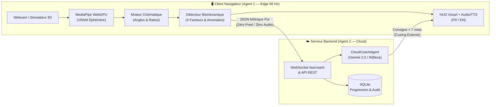

# 🏋️‍♂️ Edge Live-Coach — Coaching Biomécanique IA (Edge / Cloud)

[](./LICENSE)
[](https://nodejs.org/)
[](https://www.typescriptlang.org/)
[](#confidentialit%C3%A9-z%C3%A9ro-m%C3%A9dia-privacy-by-design)
[](#internationalisation-i18n-extensible)

**Edge Live-Coach** est une plateforme d'analyse biomécanique en temps réel et de coaching sportif assisté par IA. Elle repose sur une architecture hybride **Dual-Agent (Edge 60 Hz + Cloud LLM)** garantissant une **confidentialité absolue (Zéro Vidéo / Zéro Audio enregistrés)**, une **internationalisation complète (FR / EN + extensible)** et une **accessibilité universelle** (personnes malentendantes et malvoyantes).

---

## ✨ Fonctionnalités Clés

- **⚡ Agent 1 (Edge Vision 60 Hz)** :
  - Détection de pose 3D temps réel dans le navigateur via **MediaPipe Pose Landmarker (WebGPU / WASM)**.
  - Extraction des invariants cinématiques avec filtrage exponentiel anti-bruit (`ExponentialFilter`) : angles de flexion des genoux, inclinaison du buste, ratio d'écartement transversal (valgus), et machine à états du squat (`IDLE` ➔ `DESCENT` ➔ `BOTTOM` ➔ `ASCENT` ➔ `COMPLETED`).
  - **Simulateur Biomécanique Intégré** : Permet de tester instantanément sans caméra 5 scénarios (*Squat Nominal*, *Valgus Genoux*, *Descente Trop Rapide*, *Demi-Squat*, *Buste Penché*).
- **☁️ Agent 2 (Cloud LLM & Persistance SQLite)** :
  - Serveur HTTP REST & WebSocket temps réel (`/ws/coach`).
  - Génération de consignes d'action immédiates (*cueing externe*, max 7 mots) en Français ou en Anglais via **Google Gemini 2.0 Flash** avec basculement automatique sur un moteur réflexe heuristique (`< 5 ms`).
  - Détection de l'évolution de la fatigue en cours de série et génération de bilans de fin de séance multilingues.
  - Journal d'audit de confidentialité et historique de progression multi-facteurs stockés dans **SQLite** (`node:sqlite`).
- **♿ Accessibilité Universelle (Double Canal)** :
  - **Malentendants** : Bandeau HUD XXL contrasté, flash périphérique d'alerte sur le canvas, coloration des segments articulaires en défaut et flèches directionnelles de correction.
  - **Malvoyants** : Bips rythmiques (*Earcons* synthétisés via Web Audio API) guidant chaque phase du mouvement, alerte sonore/haptique et synthèse vocale temps réel (*TTS Web Speech API* avec adaptation automatique `fr-FR` / `en-US`).
- **🌍 Internationalisation (i18n) Extensible** :
  - Support natif **Français (`fr`)** et **Anglais (`en`)** avec bascule instantanée dans l'en-tête, persistance `localStorage` et API `registerLocale()` permettant d'ajouter de nouvelles langues (`es`, `de`, `it`, etc.) sans modifier le cœur applicatif.

---

## 🏗️ Architecture Dual-Agent & Confidentialité Zéro-Média



### 🛡️ Confidentialité Zéro-Média (*Privacy by Design*)
Aucun flux vidéo ni audio n'est jamais enregistré sur disque ni transmis sur le réseau. Les images de la webcam sont traitées à la volée en mémoire graphique (VRAM) par l'Agent 1 puis immédiatement détruites. Seul un vecteur mathématique anonymisé (angles en degrés, ratios géométriques, durées en secondes) est transmis à l'Agent 2 en cas d'anomalie.

---

## 🌍 Internationalisation (i18n) Extensible

L'architecture i18n (`src/i18n/`) repose sur un registre de dictionnaires typés avec parité stricte des clés entre `fr` et `en`, interpolation de variables (`{var}`) et mise à jour réactive du DOM (`[data-i18n]`) ainsi que de la synthèse vocale (`fr-FR` / `en-US`) et du moteur de coaching Cloud (`lang: 'fr' | 'en'`).

### Ajouter une nouvelle langue dynamiquement
```typescript
import { registerLocale, setLocale } from './src/i18n';

registerLocale('es', {
  'header.title': 'Entrenador en Vivo Edge / Cloud',
  'phase.IDLE': 'LISTO',
  'hud.repValidated': 'Repetición #{rep} completada ({duration}s) — Puntuación: {score}%'
});

setLocale('es');
```

---

## 🚀 Installation & Démarrage Rapide

### Prérequis
- **Node.js** `>= 22.5.0` (requis pour le support natif de `node:sqlite`)
- **npm** `>= 10.0.0`

### 1. Cloner et installer
```bash
git clone https://github.com/IAlexy/edge-live-coach.git
cd edge-live-coach
npm install
```

### 2. Configuration (Optionnelle)
Copiez le fichier `.env.example` en `.env` si vous souhaitez utiliser l'API Google Gemini pour l'Agent 2 (sans clé API, le moteur réflexe heuristique intégré prend automatiquement le relais avec une latence `< 5 ms`) :
```bash
cp .env.example .env
```

### 3. Lancer l'application
Ouvrez deux terminaux :
```bash
# Terminal 1 : Serveur Backend Cloud (Port 8000)
npm run dev:backend

# Terminal 2 : Interface Frontend Vite (Port 5173)
npm run dev
```
Puis ouvrez `http://localhost:5173` dans votre navigateur.

---

## 🧪 Tests Automatisés & Qualité SonarQube

Le projet dispose d'une suite complète de tests exécutée avec **Vitest** et **JSDOM**, ainsi que d'une configuration **SonarQube / SonarCloud** (`sonar-project.properties`) et d'un pipeline **GitHub Actions CI** (`.github/workflows/ci.yml`) :

```bash
# Lancer l'ensemble des tests (Unitaires + i18n + API/WebSocket + Interface UI)
npm test

# Lancer uniquement les tests unitaires (Cinématique, Détecteur, Simulateur, Agent LLM, Accessibilité, i18n)
npm run test:unit

# Lancer uniquement les tests des routes API REST & WebSocket
npm run test:api

# Lancer uniquement les tests d'interface DOM, i18n & Canvas HUD
npm run test:ui

# Vérifier le typage TypeScript strict
npm run typecheck
```

---

## 📡 Référence API & WebSocket (Agent 2)

### Routes HTTP REST (`http://localhost:8000`)

| Méthode | Route | Description |
| :--- | :--- | :--- |
| `GET` | `/api/health` | État de santé du serveur et statut de confidentialité (`ZERO_MEDIA`). |
| `GET` | `/api/progression/history?limit=15` | Historique des sessions d'entraînement et moyennes des 4 facteurs. |
| `GET` | `/api/progression/session/:id` | Détail de toutes les répétitions scorées d'une session. |
| `POST` | `/api/coach/infer` | Inférence synchrone d'une correction à partir d'un payload d'anomalie (`lang?: 'fr' \| 'en'`). |
| `GET` | `/api/audit/logs?limit=30` | Journal d'audit de confidentialité (prompts générés et réponses). |
| `DELETE` | `/api/audit/logs` | Purge le journal d'audit SQLite. |

### Protocole WebSocket (`ws://localhost:8000/ws/coach`)

- **Messages Client ➔ Serveur** :
  - `ANOMALY_EVENT` : Envoie les métriques d'une anomalie détectée par l'Agent 1 (avec la langue active `lang`).
  - `REP_SCORES` : Enregistre les scores multi-facteurs (`stability`, `tempo`, `depth`, `posture`, `global`) d'une répétition validée.
  - `END_SESSION` : Demande la synthèse et le bilan de progression de la série (`lang?: 'fr' | 'en'`).
- **Messages Serveur ➔ Client** :
  - `CONNECTED` : Confirmation de connexion avec identifiant de session et historique récent.
  - `COACHING_CUE` : Consigne corrective immédiate, zone d'action et latence d'inférence.
  - `REP_SCORE_SAVED` : Confirmation de persistance SQLite de la répétition.
  - `SESSION_DEBRIEF` : Bilan complet de fin de séance (volume, analyse de fatigue, régularité).

---

## 📁 Structure du Projet

```text
edge-live-coach/
├── .github/workflows/ci.yml   # Pipeline CI/CD GitHub Actions & SonarQube
├── backend/
│   ├── db.ts                  # Couche de persistance SQLite (sessions, reps, audit)
│   ├── llm_agent.ts           # Agent 2 Cloud (Prompt builder Zéro-Média FR/EN, Gemini & fallback)
│   └── server.ts              # Serveur HTTP REST & WebSocket (/ws/coach)
├── src/
│   ├── i18n/                  # Système d'internationalisation extensible (FR, EN + registerLocale)
│   │   ├── locales/
│   │   │   ├── fr.ts          # Dictionnaire Français complet
│   │   │   └── en.ts          # Dictionnaire Anglais complet
│   │   └── index.ts           # Registre i18n, interpolation, persistance et binding DOM
│   ├── accessibility.ts       # Synthèse audio Web Audio (Earcons), haptique & TTS multilingue
│   ├── agent2_bridge.ts       # Client WebSocket & pont événementiel Agent 1 -> Agent 2
│   ├── detector.ts            # Machine à états du squat, détection d'anomalies & scoring
│   ├── kinematics.ts          # Calculs géométriques 3D/2D & filtrage exponentiel
│   ├── main.ts                # Contrôleur principal de l'application (LiveCoachApp)
│   ├── simulator.ts           # Générateur procédural de mouvements et d'anomalies
│   ├── style.css              # Design système sombre haute visibilité (WCAG)
│   ├── types.ts               # Interfaces TypeScript partagées
│   └── visuals.ts             # Rendu Canvas 2D du squelette et alertes visuelles
├── tests/
│   ├── unit/                  # Tests unitaires (kinematics, detector, simulator, llm, audio, i18n)
│   ├── api/                   # Tests d'intégration des routes HTTP & WebSocket
│   └── ui/                    # Tests d'interface DOM, sélecteur i18n, contrôles et rendu HUD
├── index.html                 # Interface utilisateur principale
├── sonar-project.properties   # Configuration SonarQube / SonarCloud
├── vite.config.ts             # Configuration Vite
├── vitest.config.ts           # Configuration Vitest
└── tsconfig.json              # Configuration TypeScript stricte
```

---

## 📄 Licence

Distribué sous licence **MIT**. Voir le fichier [LICENSE](./LICENSE) pour plus d'informations.
